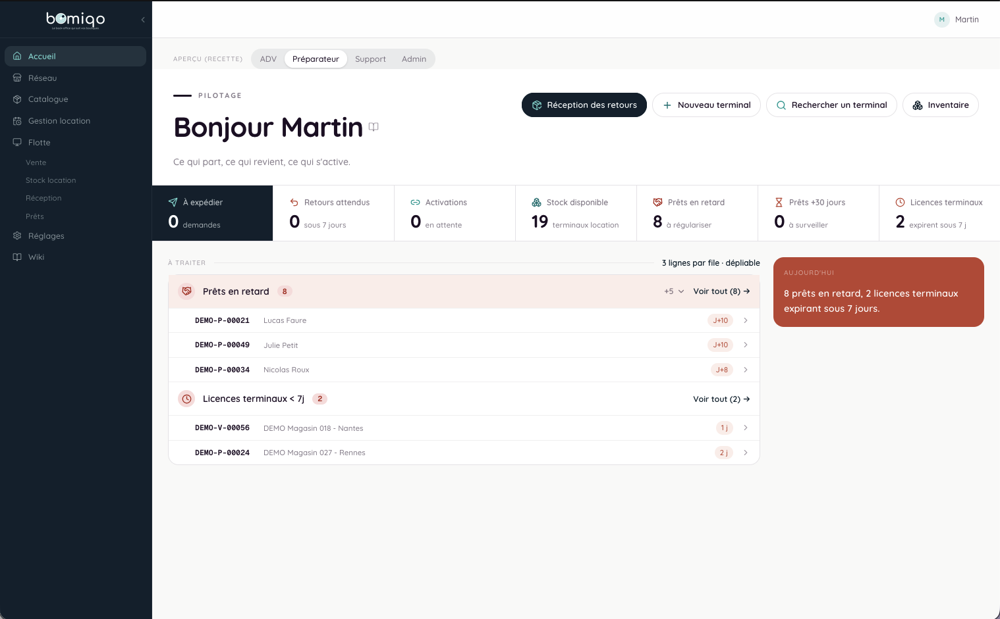
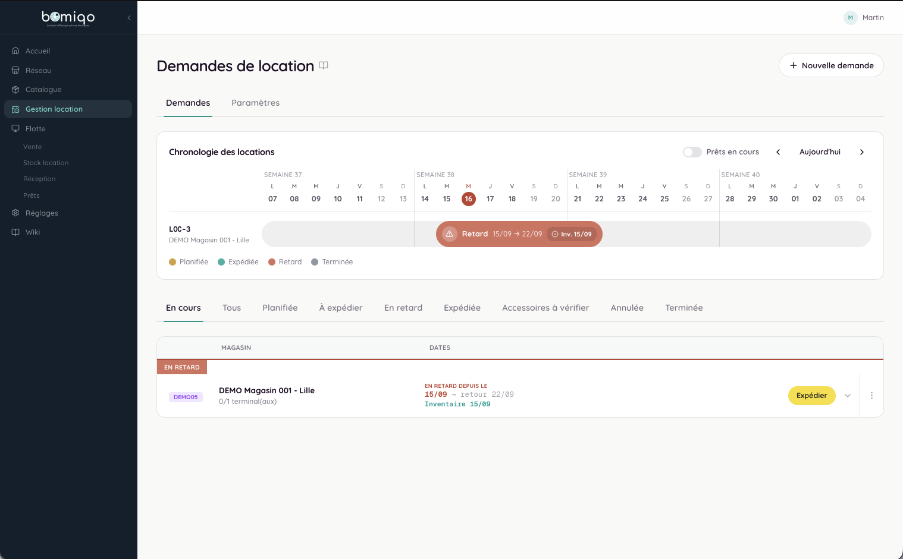
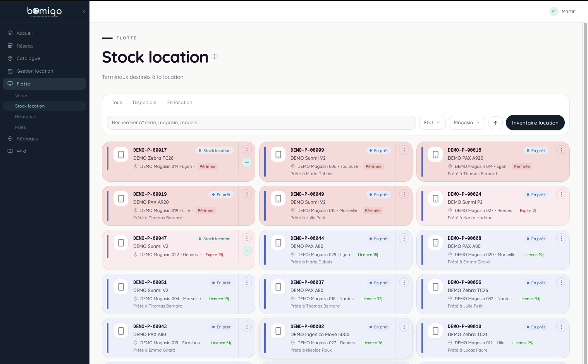
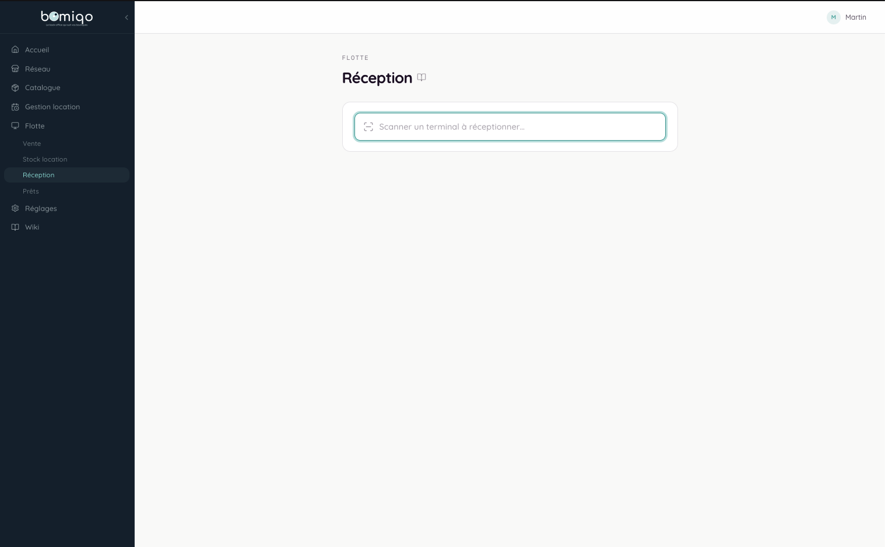
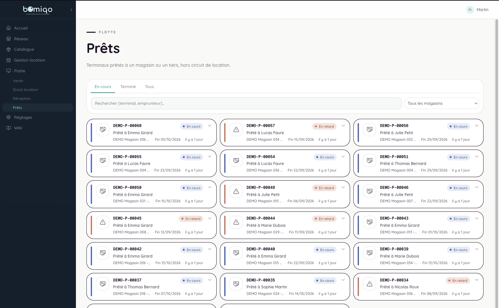
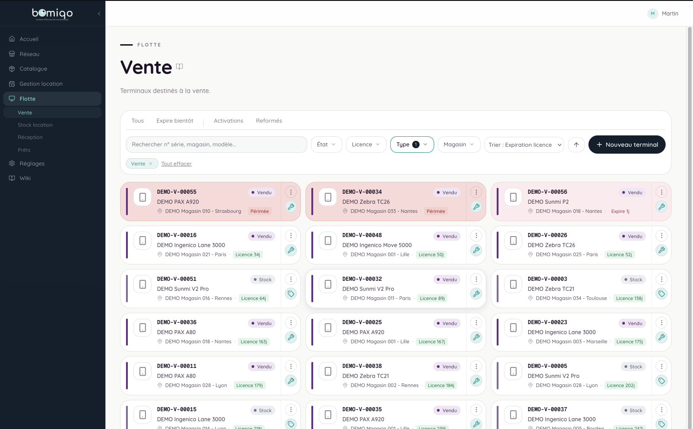

## Context

AMOPI manages a multi-brand franchise network (ADBB / BB9 / BVES). Its business relies on three things in particular:

- **inventory terminals** that AMOPI lends to the network's retail chains so they can run their inventories;
- **software deployed at client sites**, protected by a licensing system;
- **the clients' technical infrastructure**: details about their servers (IP addresses, credentials, etc.).

## The need

AMOPI needed a single tool to:

- track each terminal loan from start to finish: shipping date, delivery date at the client's, expected and actual return dates;
- manage the licenses for software installed at client sites;
- have client servers' technical details at hand without collecting them manually;
- control precisely who can access what, and keep a record of actions on sensitive items: equipment, sales, rentals, loans, after-sales service.

## The solution

I built BOMIQO, a web back office that brings these needs together: terminal rental, license management, and syncing clients' infrastructure.

- **Licenses are verified by BOMIQO itself**, with no separate or third-party service.
- **Client servers' technical details update automatically** from the clients' database.
- **Each user only sees what concerns them**, with fine-grained access rights enforced throughout the application.
- **Sensitive actions are logged** (equipment, sales, rentals, loans, after-sales service).

## Features

The main screens are shown in the screenshots below. In addition:

- **Licenses**: validated directly by the back office.
- **Client infrastructure**: automatic retrieval of server IPs, logins, etc.
- **Access rights**: fine-grained, scope-based permissions.
- **Action history**: covering equipment, sales, rentals, loans, and after-sales service.

*Home: overdue loans, licenses about to expire, available stock, and quick actions (receiving, new terminal, search, inventory).*

*Rental management: timeline of rental requests by store, with statuses (scheduled, shipped, overdue, completed).*

*Rental stock: grid of terminals set aside for rental, with each device's status and license countdown.*

*Receiving: scanning a returned terminal to close out its loan.*

*Loans: terminals lent outside the rental workflow, with due dates and overdue items.*

*Sales: terminals intended for sale, with license expiration tracking.*

### Coming next

A store-facing portal is planned down the road, so each chain can view its own numbers directly.

## Results

A robust back-office platform, tested under real-world conditions through a structured acceptance-testing protocol organized by functional area: terminal rental, license management, infrastructure syncing, and after-sales operations.

## Under the hood

| Action | Technology | Details |
|--------|------------|---------|
| Track a terminal loan | Django + PostgreSQL | Shipping, delivery, and return dates. |
| Manage a software license | Django (built-in verification server) | Validated directly by the backend, with no third-party service. |
| Sync client infrastructure | Django + MySQL connection | Automatic retrieval of server IPs, logins, etc. |
| Manage access | DRF + JWT (simplejwt) + `HasPerm` permissions | Fine-grained, scope-based permissions enforced in both the API and the UI. |
| Audit actions | Django audit trail | Covers equipment, sales, rentals, loans, and after-sales service. |

### Architecture

- The license verification server is built directly into the Django backend (no separate service).
- Infrastructure syncing reads from a MySQL database, driven by Django.
- The backend follows a hexagonal architecture organized into vertical slices: each Django app (foundation, materiel, auth_api, audit...) cleanly separates models, business logic (services), data access (repositories), and the API (serializers/views), keeping views thin and business logic testable independently of DRF.
- The frontend takes a "hook-first" approach built on feature slices: each feature is a self-contained folder with its own types, React Query hooks for API calls, and purely presentational components.

### Technical challenges

- Designing a fine-grained, consistent permission system (`HasPerm` + scopes) that applies uniformly to both the API and the UI.
- Building a reliable audit trail covering all sensitive business models (equipment, sales, rentals, loans, after-sales service).
- Making the automatic sync from clients' MySQL databases reliable, even though their availability and schema are outside BOMIQO's direct control.
- Securing the built-in license verification server so it doesn't become a way to bypass licensing.
- Keeping the codebase strictly modular (line limits per file type) to force decomposition rather than piling up complexity.
