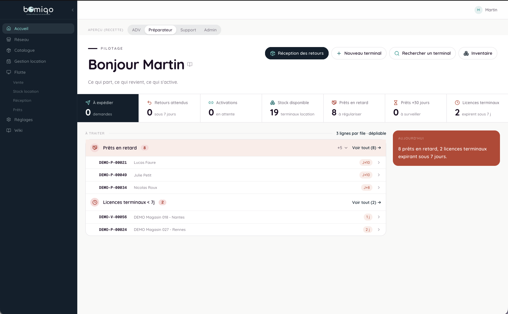
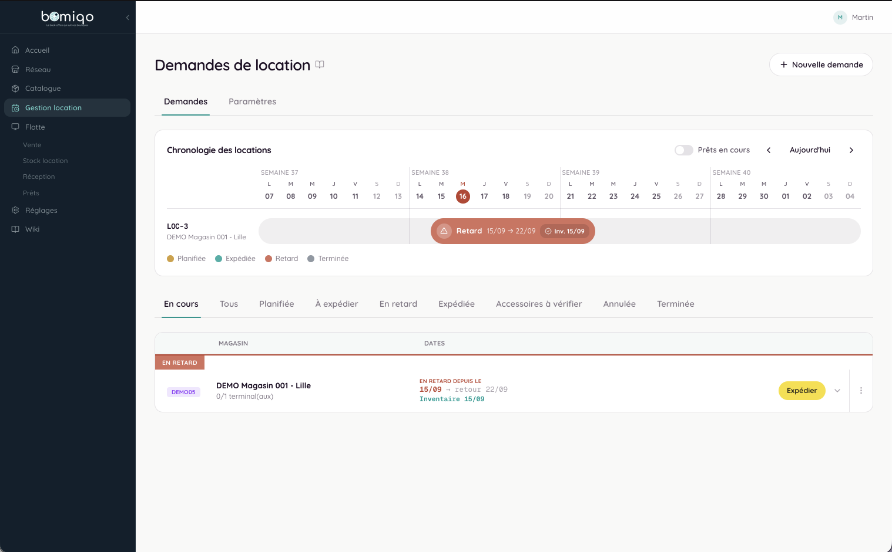
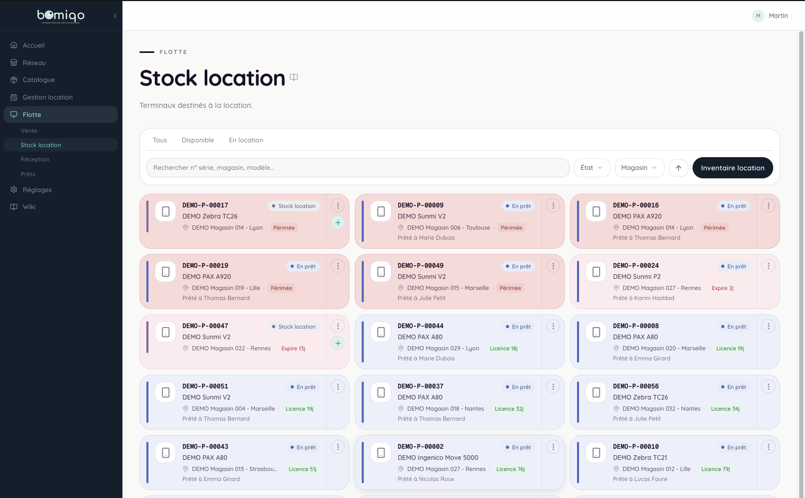
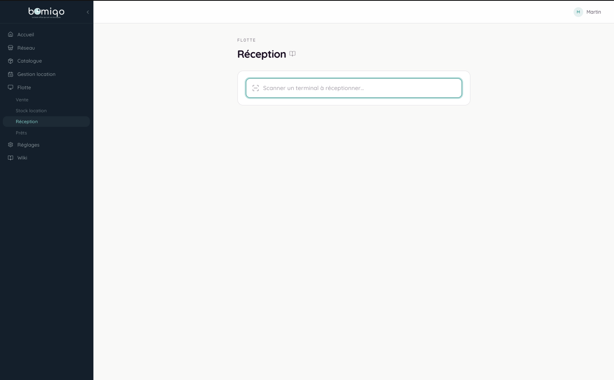
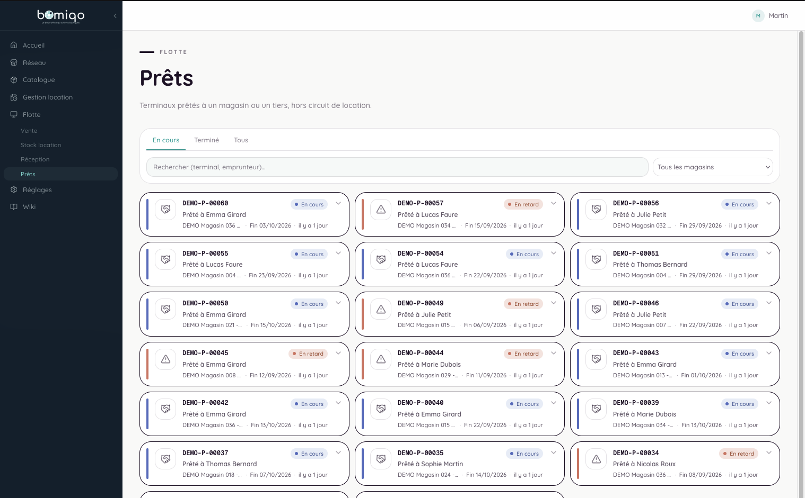
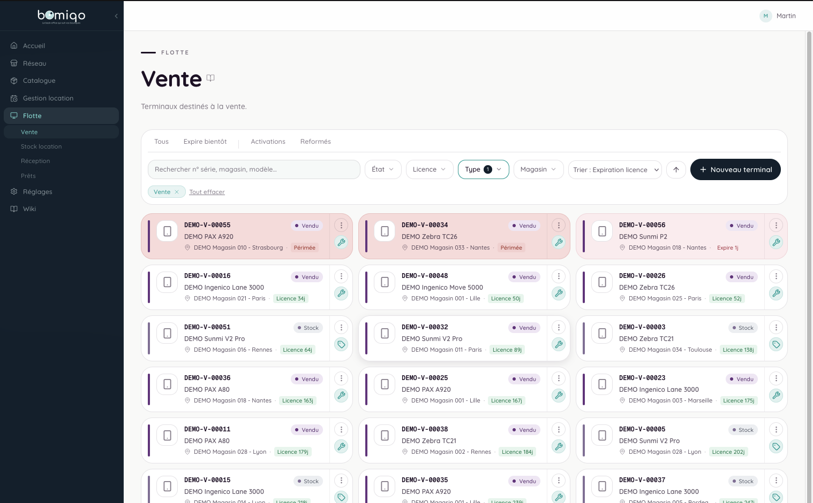

## Contexte

AMOPI gère un réseau franchisé multi-enseignes (ADBB / BB9 / BVES). Son activité repose notamment sur trois choses :

- **les terminaux d'inventaire** qu'AMOPI prête aux enseignes pour faire leurs inventaires ;
- **les logiciels déployés chez les clients**, protégés par un système de licences ;
- **l'infrastructure technique des clients** : les informations de leurs serveurs (adresse IP, identifiants, etc.).

## Le besoin

AMOPI avait besoin d'un seul outil pour :

- suivre chaque prêt de terminal de bout en bout : date d'expédition, date de livraison chez le client, date de retour prévue et effective ;
- gérer les licences des logiciels installés chez les clients ;
- disposer des informations techniques des serveurs clients sans aller les chercher à la main ;
- contrôler finement qui a accès à quoi, et garder une trace des actions sur les sujets sensibles : matériel, ventes, locations, prêts, SAV.

## La solution

J'ai développé BOMIQO, un backoffice web qui réunit ces besoins : la location de terminaux, la gestion des licences et la synchronisation de l'infrastructure des clients.

- **Les licences sont vérifiées par BOMIQO lui-même**, sans service séparé ni service tiers.
- **Les informations techniques des serveurs clients se mettent à jour automatiquement** depuis la base de données des clients.
- **Chaque utilisateur n'accède qu'à ce qui le concerne**, avec des droits fins appliqués partout dans l'application.
- **Les actions sensibles sont tracées** (matériel, ventes, locations, prêts, SAV).

## Fonctionnalités

Les écrans principaux sont détaillés dans les captures ci-dessous. En complément :

- **Licences** : validation directe par le backoffice.
- **Infrastructure client** : récupération automatique des IP des serveurs, des identifiants, etc.
- **Droits d'accès** : permissions fines par périmètre.
- **Historique des actions** : sur le matériel, les ventes, les locations, les prêts et le SAV.

*Accueil : prêts en retard, licences arrivant à expiration, stock disponible et actions rapides (réception, nouveau terminal, recherche, inventaire).*

*Gestion location : chronologie des demandes de location par magasin, avec statuts (planifiée, expédiée, en retard, terminée).*

*Stock location : grille des terminaux destinés à la location, avec statut et compte à rebours de licence par appareil.*

*Réception : scan d'un terminal retourné pour clôturer son prêt.*

*Prêts : terminaux prêtés hors circuit de location, avec échéances et retards.*

*Vente : terminaux destinés à la vente, avec suivi de l'expiration de licence.*

### À venir

Un espace magasin est envisagé à terme, pour que chaque enseigne consulte directement ses propres chiffres.

## Résultats

Une plateforme backoffice robuste, testée en conditions réelles selon un protocole de recette structuré par blocs fonctionnels : location de terminaux, gestion des licences, synchronisation d'infrastructure et opérations SAV.

## Côté technique

| Action | Technologie | Détail |
|--------|-------------|--------|
| Suivre un prêt de terminal | Django + PostgreSQL | Dates d'expédition, livraison et retour. |
| Gérer une licence logicielle | Django (serveur de vérification intégré) | Validation directe depuis le backend, sans service tiers. |
| Synchroniser l'infra client | Django + connexion MySQL | Récupération automatique IP serveur, logins, etc. |
| Gérer les accès | DRF + JWT (simplejwt) + permissions `HasPerm` | Permissions fines par scope, appliquées côté API et UI. |
| Auditer les actions | Audit trail Django | Couvre matériel, ventes, locations, prêts, SAV. |

### Architecture

- Le serveur de vérification de licences est intégré directement au backend Django (pas de service séparé).
- La synchronisation de l'infrastructure lit une base MySQL, pilotée par Django.
- Le backend suit une architecture hexagonale organisée en slices verticaux : chaque app Django (foundation, materiel, auth_api, audit...) sépare clairement les modèles, la logique métier (services), l'accès aux données (repositories) et l'API (serializers/views), pour garder les vues fines et la logique métier testable indépendamment de DRF.
- Le frontend suit une approche « hook-first » en feature slices : chaque fonctionnalité est un dossier autonome avec ses types, ses hooks React Query pour les appels API, et des composants qui ne font que du rendu.

### Défis techniques

- Concevoir un système de permissions fin et cohérent (`HasPerm` + scopes) applicable uniformément côté API et côté UI.
- Mettre en place un audit trail fiable couvrant l'ensemble des modèles métier sensibles (matériel, ventes, locations, prêts, SAV).
- Fiabiliser la synchronisation automatique depuis la base MySQL des clients, dont la disponibilité et le schéma échappent au contrôle direct de BOMIQO.
- Sécuriser le serveur de vérification de licences intégré, pour éviter qu'il ne devienne un point de contournement.
- Garder une base de code strictement modulaire (limites de lignes par type de fichier) pour forcer le découpage plutôt que l'accumulation de complexité.
